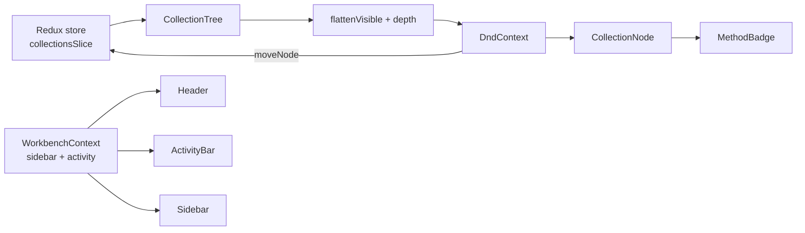

## Rest Fox UI Foundation

This phase rebrands the existing VSCode-style workbench into an API testing tool UI. It only touches the three chrome components around the main content area (ActivityBar, Sidebar, Header/TitleBar) plus the tooling setup. Tabs/request bar/request panel/response panel/statusbar are deferred.

### 1. Tooling & dependencies

Install via `yarn`:

- `tailwindcss`, `postcss`, `autoprefixer`, `@tailwindcss/vite` - Tailwind v4 for shadcn. Scope Tailwind's reset so it does NOT fight the existing layout CSS (target only elements inside shadcn components via a preflight opt-out / `corePlugins: { preflight: false }` + manual resets inside shadcn primitives).
- `lucide-react` - icons for ActivityBar, Header, Sidebar folder/method rows.
- `class-variance-authority`, `clsx`, `tailwind-merge` - required by shadcn; reuse the project's existing `cn` utility path by upgrading [utils/classNames.ts](vscode-ui/src/utils/classNames.ts) to the shadcn-style `clsx + tailwind-merge` implementation (keeps same `cn` name so no callsites break).
- `@reduxjs/toolkit`, `react-redux` - for the collections slice only.
- `@dnd-kit/core`, `@dnd-kit/sortable`, `@dnd-kit/utilities` - tree drag-and-drop.

Also:

- Add Vite path alias `@ -> ./src` in [vite.config.ts](vscode-ui/vite.config.ts) and matching `paths` in [tsconfig.app.json](vscode-ui/tsconfig.app.json).
- Initialize shadcn: create `components.json` manually (avoid `shadcn init` overwriting structure), configured to place primitives under `src/components/ui/` and import alias `@/components/ui`.
- Do NOT install shadcn's `sidebar` or `resizable` primitives per user's requirement.

### 2. State management (hybrid)

Keep [context/WorkbenchContext.tsx](vscode-ui/src/context/WorkbenchContext.tsx) for layout UI state (sidebar width/hidden, active activity, panes). Strip tree-related actions (`TOGGLE_TREE_NODE`, `SELECT_TREE_NODE`, the `tree` field) out of [context/workbenchReducer.ts](vscode-ui/src/context/workbenchReducer.ts).

Add a minimal Redux store for the request tree only:

- `src/store/index.ts` - `configureStore({ reducer: { collections } })`, exports `RootState`/`AppDispatch`.
- `src/store/hooks.ts` - typed `useAppSelector` / `useAppDispatch`.
- `src/store/slices/collectionsSlice.ts` - holds a nested tree of collection nodes, selection, expanded set, plus reducers:
  - `toggleExpanded(id)`, `selectNode(id)`
  - `addFolder({ parentId })`, `addRequest({ parentId, method })`
  - `renameNode({ id, name })`, `deleteNode(id)`
  - `moveNode({ sourceId, targetParentId, index })` - used by drag-and-drop; validates no cycles.
- Wrap `App` with both providers:

```tsx
<Provider store={store}>
  <WorkbenchProvider>
    <Workbench />
  </WorkbenchProvider>
</Provider>
```

### 3. Domain model

Replace [types/index.ts](vscode-ui/src/types/index.ts)'s `TreeItem`/`FileType` with:

```ts
export type HttpMethod = 'GET' | 'POST' | 'PUT' | 'PATCH' | 'DELETE' | 'HEAD' | 'OPTIONS';

export interface CollectionFolder {
  id: string;
  type: 'folder';
  name: string;
  children: CollectionNode[];
}

export interface CollectionRequest {
  id: string;
  type: 'request';
  name: string;
  method: HttpMethod;
}

export type CollectionNode = CollectionFolder | CollectionRequest;
```

Move it into `src/types/collections.ts`. Delete tree-view-only fields (`level`, `open`, `selected`) - those move to the slice (`expandedIds: Set<string>`, `selectedId: string | null`).

Seed data goes in `src/data/initialCollections.ts` (replaces [data/fileTree.ts](vscode-ui/src/data/fileTree.ts)) with a nested example mirroring the screenshot (Stage, Partner Portal > marketplace > spot-trs, Admin Portal > Transport Request, etc.).

Add `src/utils/tree.ts` helpers: `findNode`, `findParent`, `removeNode`, `insertNode`, `isDescendant`, `flattenVisible` (used by the DnD layer).

### 4. ActivityBar

Files to change: [components/ActivityBar/ActivityBar.tsx](vscode-ui/src/components/ActivityBar/ActivityBar.tsx), [components/ActivityBar/ActivityBar.css](vscode-ui/src/components/ActivityBar/ActivityBar.css), [data/activityBarItems.ts](vscode-ui/src/data/activityBarItems.ts). Delete `components/ActivityBar/icons.tsx` and `iconMap.ts`.

- Items (top): `Collections` (`FolderTree`), `Search` (`Search`), `Environments` (`Layers`), `Source Control` (`GitBranch`), `History` (`History`).
- Items (bottom): `Settings` (`Settings`).
- Render lucide icons directly; keep current CSS (active-indicator bar on the left, hover states) - those already match the reference.
- Identifiers in [data/constants.ts](vscode-ui/src/data/constants.ts) become `ACTIVITY_COLLECTIONS`, `ACTIVITY_SEARCH`, `ACTIVITY_ENVIRONMENTS`, `ACTIVITY_SCM`, `ACTIVITY_HISTORY`, `ACTIVITY_SETTINGS`. Update reducer's `INITIAL_STATE.activeActivity` to `ACTIVITY_COLLECTIONS`.

### 5. Header (replaces TitleBar)

Rename folder `components/TitleBar/` -> `components/Header/` and rewrite. Keep existing CSS file (renamed `Header.css`) as plain CSS - just refresh classnames and sections.

Structure (three-slot flex row using existing plain CSS grid):

- Left: `Logo` component - lucide icon + wordmark ("Rest Fox").
- Middle: `SearchBar` - shadcn `Input` wrapped with a lucide `Search` adornment; `max-width` constrained in CSS so it stays centered.
- Right: `HeaderActions` - two icon buttons:
  - `PanelLeftClose` / `PanelLeftOpen` (toggles primary sidebar via existing `SET_SIDEBAR_HIDDEN` action).
  - A second optional toggle slot reserved for the right-side response/request layout later.

Remove the old traffic-light window controls and centered title/menu (they don't fit an API testing tool).

### 6. Sidebar

Files: rewrite [components/Sidebar/Sidebar.tsx](vscode-ui/src/components/Sidebar/Sidebar.tsx), replace [components/Sidebar/FileTree.tsx](vscode-ui/src/components/Sidebar/FileTree.tsx) and [components/Sidebar/FileTreeRow.tsx](vscode-ui/src/components/Sidebar/FileTreeRow.tsx) with the new tree. Keep `Sidebar.css` + `FileTree.css` (renamed to `CollectionTree.css`) - plain CSS only.

New sub-components in `components/Sidebar/`:

- `CollectionTree.tsx` - reads nested tree from RTK, flattens visible nodes, wraps rows in `DndContext` + `SortableContext` (`@dnd-kit`).
- `CollectionNode.tsx` - a single row. Renders:
  - Chevron (`ChevronRight` / `ChevronDown`) for folders, hidden for requests.
  - `FolderIcon` (single lucide `Folder` - no color variants) for every folder.
  - `MethodBadge` for requests - a small colored text label (`GET`, `POST`, ...) instead of a file-type icon. Colors match the screenshot:
    - `GET` green, `POST` yellow/orange, `PUT` blue, `PATCH` teal, `DELETE` red, `HEAD`/`OPTIONS` neutral.
  - Label.
  - Uses `useSortable({ id })`; indent driven by computed `depth` in the flat list (not stored on the node).
- `MethodBadge.tsx` - tiny presentational component; colors defined in `Sidebar.css` via `data-method="GET"` etc. (no inline styles, per project rule).
- `SidebarHeader.tsx` - panel title ("Collections") + action icons (`FilePlus`, `FolderPlus`, `RefreshCw`, `MoreHorizontal`) to match the reference screenshot, using lucide.

Drag-and-drop behavior (matches user's requirement "change the order and move in or out of folders"):

- Flatten strategy: compute `FlatNode[]` from nested tree with `depth`, `parentId`, `index`.
- On `onDragOver`, compute a `projected` drop target (parentId + index) using the pointer's x-position to detect "indent into this folder" vs "drop between siblings" (pattern from @dnd-kit's sortable-tree example).
- On `onDragEnd`, dispatch `moveNode({ sourceId, targetParentId, index })`.
- Guard against dropping a folder into its own descendants.

### 7. Cleanup / consequences

- Editor area, Sash, StatusBar, hooks (`useDragSash`, `useSidebarLayout`), and the overall Workbench grid layout remain untouched.
- Delete now-dead `components/ActivityBar/icons.tsx`, `iconMap.ts`, `utils/fileIcons.ts`, `data/codeSnippets.ts` (only referenced by editor demo; keep if editor still renders) - verify before deletion. `data/codeSnippets.ts` is used by the EditorArea demo, so keep it.
- Update [README.md](vscode-ui/README.md) briefly to describe the new stack (Tailwind + shadcn + lucide + dnd-kit + RTK).

### Data flow diagram

